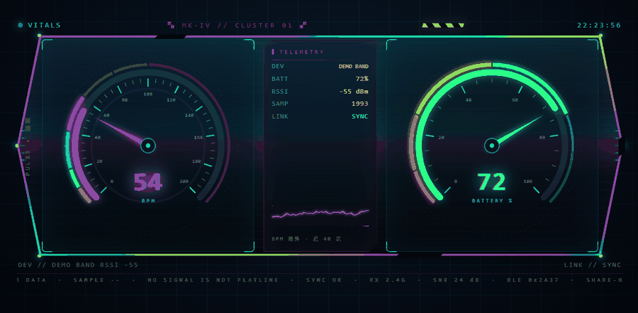

# DSH 小工具计划 · dsh-tools-plan

给 AI agent 用的小工具集合，一个项目一个目录，能单独拿走用。

> 所有工具都遵守同一条：**只监听本机、不上传数据、配置与素材不进仓库**。

---

# Heart Rate Overlay（小米手环心率 → OBS / 桌面小窗）

把小米手环的 **Share HR（心率广播）** 接进电脑，做成能塞进 OBS 的实时心率浮层，或者一个置顶小窗。

- 浏览器源直接可用（不用编译 OBS 插件）
- 自带可视化设置页：图标、字号、圆角、玻璃底、分档颜色、电量圆环……拖滑块即时生效
- 皮肤（整套外观）与 DIY（单品微调）分开，皮肤放 `overlay/skins/*.html` 就能被设置页列出来
- 只监听 `127.0.0.1`，不联网、不上传任何数据

> **第一次用？直接看 [docs/快速上手.md](docs/快速上手.md)** —— 从装 Python 到 OBS 出画面，共 6 步，每步都写了「这里该看到什么」。



*皮肤 `gauge`：左边实时心率、中间信息屏（设备/电量/信号/采样数/连接状态 + BPM 折线）、右边剩余电量，整体装在一个宽六边形中控台里。*

## 它怎么工作

手环在小米运动健康里打开 **Share HR** 之后，会变成一个**标准 BLE 心率带**：
广播 `0x180D` 服务，订阅 `0x2A37` 就能收到心率通知（不需要任何 auth key）。
本服务常驻后台，扫描 → 锁定你那台手环 → 订阅心率 → 通过本地 HTTP / SSE 吐给网页。

> 没开 Share HR 时，手环的心率走小米私有协议 `0xFE95`，需要 auth key，本项目**不做**。

## 准备

- Windows 10/11，系统蓝牙打开
- Python 3.9+
- 手环：设置 → **Share HR** → 打开（小米手环 10 实测）

## 安装

```bat
python -m venv .venv
.venv\Scripts\activate
pip install -r requirements.txt
```

不想用 venv 也可以直接 `pip install bleak`。

## 跑起来

1. 双击 `start-service.bat`（或 `python hr_service.py`），窗口别关
2. 浏览器打开 <http://127.0.0.1:8787/editor> 调外观
3. OBS → 来源 → 加「浏览器」，地址填：
   - `http://127.0.0.1:8787/overlay` —— DIY 浮层
   - `http://127.0.0.1:8787/skin/gauge` —— 皮肤「赛博仪表盘」

宽高建议 `900 x 300`，背景透明（浏览器源默认就支持透明）。

### 其它入口

| 地址 | 是什么 |
|:---|:---|
| `/overlay` | 浮层本体（OBS 用这个） |
| `/editor` | 可视化设置页（DIY / 皮肤两个页签） |
| `/api/hr` | 当前心率 JSON |
| `/events` | SSE 实时推送 |
| `/api/skins` | 已安装的皮肤列表 |
| `?still=1` | 关掉所有动画（省 GPU） |

### 桌面小窗

`start-window.bat`（或 `python hr_window.py`）：无边框置顶小窗，左键拖动，右键菜单，Esc 退出。
它只读 `/api/hr`，不开蓝牙——所以必须先把服务跑起来。

## 锁定你的手环

默认按「广播里有 `0x180D` + 名字含 `Smart Band` + RSSI 够强」打分，**全场唯一最高分**才连，
两台同分就拒绝（防止串台）。想更稳就把自己的 MAC 写进 `config.json`：

```json
{ "device": { "mac": "AA:BB:CC:DD:EE:FF" } }
```

MAC 可以在 `python ble_hr.py scan` 的输出里看到。

## 配置

`config.json`（第一次改设置时会自动生成，示例见 `config.example.json`）：

- `device.mac` —— 精确锁定，留空则自动挑
- `device.name_match` —— 名字关键词
- `device.min_rssi` —— 信号弱于此值不连
- `zones[]` —— 心率分档（名字 / 上下限 / 颜色 / 每档图标与 GIF）
- `theme` —— 浮层外观，设置页就是改这里

## 电量

连上后读标准 GATT `0x2A19`，连上读一次、之后每 5 分钟一次。
显示成圆环或电池条，数字可选环内 / 旁边 / 隐藏。

> 小米的「真实电量」在私有 `0xFE95` 里，需要 auth key，本项目不碰；这里读到的是标准 Battery Level。

## 程序时长（可选）

想显示「某个程序已经跑了多久」：

1. 设置页 → **DIY 调整** → 点开「程序时长」芯片
2. 在下拉框里选一个正在跑的程序（列表来自服务端枚举，纯 ctypes，不装 psutil）
3. 浮层右侧就多一行 `时长 1:23:45`

细节：

- 数据来自 `/api/game`（`game_watch.py` 用进程启动时间算，不读目标进程内存、不 hook）
- 秒数是**本地递推**的，每 10 秒回服务端校一次，所以看着是连续跳的
- 「计时阈值」（`ring_hours`）只影响皮肤 `gauge4` 里那个圆环的进度，不影响数字
- 程序关掉那一刻，行会自动消失

## 皮肤

`overlay/skins/` 下每个 `.html` 就是一套皮肤，设置页「皮肤」页签会自动列出来。
自带两套：`gauge`（赛博仪表盘，宽六边形中控台）、`gauge4`（三盘横排）。

自己写皮肤：照着现成的抄，页面里 `fetch('/api/hr')` + `EventSource('/events')` 拿数据即可。

## 常见问题

| 现象 | 原因 |
|:---|:---|
| 一直「没扫到目标手环」 | 手环 Share HR 没开；或手环离太远；或已经被手机连走了 |
| 连上了但没数字 | 连错设备了（锁策略会 20 秒后自动断开重扫） |
| OBS 里一片黑 | 浏览器源尺寸太小 / 地址少了 `/overlay` / 服务没开 |
| 改了文件网页没变 | 浏览器缓存，Ctrl+F5；OBS 里右键源 →「刷新页面」 |

## 目录

```
hr_service.py        常驻服务：BLE + HTTP/SSE + 设置页后端
ble_hr.py            命令行排障：scan / watch
hr_window.py         桌面小窗（tkinter）
game_watch.py        进程运行时长（可选模块，给「程序计时」用）
overlay/index.html   DIY 浮层
overlay/editor.html  可视化设置页
overlay/skins/*.html 皮肤
docs/快速上手.md      从零到出画面，6 步走完
docs/方法.md          更细的实现说明与踩坑记录
```

## 许可

自己玩就行。要正式开源请自行加一个 LICENSE（MIT / Apache-2.0 都合适）。
